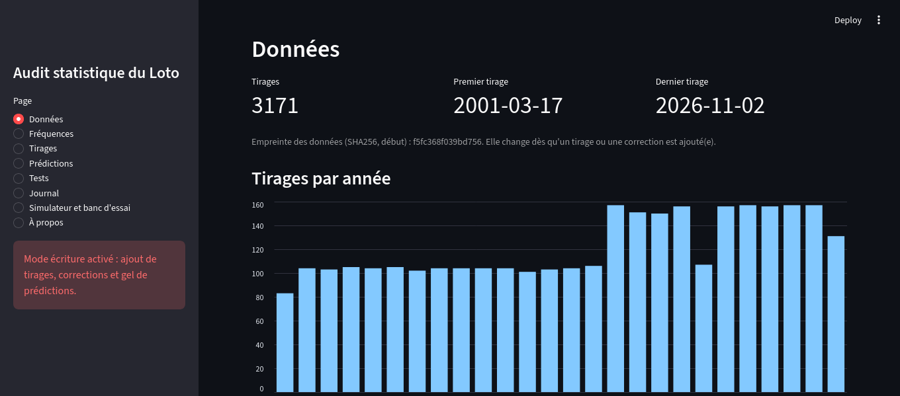
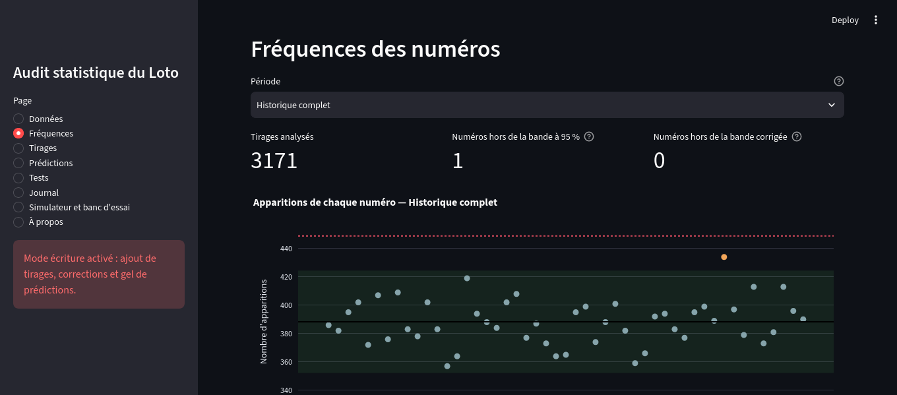
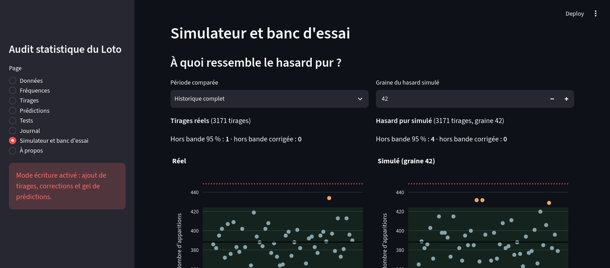

# loto-research — LOTO MAROC Research Engine

**English** · [Français](#français)





## English

> **Result.** On 3,155 draws of Morocco's Loto 6/49 (2001-03-17 → 2026-09-26), **no exploitable statistical structure
> was detected and no predictive power was measured.** Uniformity, dependence between draws, regime changes, pairs,
> triplets: nothing robust. Three models (uniform random, smoothed frequency, logistic regression) were tested
> out of sample (walk-forward, 2,655 draws): none beat chance. One isolated result on the bonus ball (raw p = 0.0235)
> did not survive the checks. See `reports/FINAL.md`.
>
> **Limits.** Absence of evidence is not evidence of absence: a bias on a single number must reach about 22 % of its
> frequency to be detected 80 % of the time (3,155 draws). The source file, retrieved from the official website, was
> repaired by hand without a change log, and a systematic cross-check against the site is not documented. No physical
> information on the draw machine is available.

### What this is, and what it is not

A toolbox to audit "k numbers out of N" lotteries statistically, with guard rails: multiple-testing correction,
hypotheses declared **before** looking at data, no time leakage, append-only data, and detectors checked on simulated
draws with known biases.

It is **not** a tipping tool. No combination is recommended and no number is rated more or less likely than another:
every combination of the 6/49 has a probability of 1 in 13,983,816. It never concludes to fraud.

### What is inside

| Part | What it does |
|---|---|
| Audit engine | Frequencies, uniformity (Monte-Carlo reference), gaps, pairs/triplets (FDR), temporal tests, change points, walk-forward backtest |
| SQLite store | Append-only draws, mandatory source per draw, corrections that never edit the original |
| Hypothesis registry | Pre-registration with a fixed target size (`n_star`): one confirmatory test, only on later draws |
| Simulator and benchmark | False-positive rate under pure chance and detection power for known biases (`reports/BENCHMARK_M4.md`) |
| Local dashboard | Streamlit, no ranking of numbers, confidence bands, comparison with pure chance; adding draws, corrections, backups and predictions with a few clicks |
| Frozen exploratory predictions | Frozen **before** each draw (cutoff 15:00 UTC on the draw day), scored afterwards, for the six numbers (H010) and the bonus ball (H011). **Not validated**: see `docs/PREDICTIONS_PROTOCOL.md` |

### Install (once), then everything is done by clicking

```bash
git clone https://github.com/faisalsafadi/loto.git && cd loto
python3.12 -m venv .venv && source .venv/bin/activate
pip install -e ".[change-points,viz,dashboard]"
bash scripts/install_launcher.sh   # creates the "Loto" icon (applications menu and desktop)
```

Then double-click the **Loto** icon: it builds the database from `data/public/loto_maroc_draws.csv` on first use, starts the
dashboard in write mode and opens your browser. The dashboard asks for missing draws, adds them from lines pasted from the
official site, freezes predictions, makes automatic backups (page *Sauvegardes*) and has a *Quit* button.

For development: `python -m pytest tests -q` (about 265 tests), `loto analyze` (quick analysis, about 2 minutes),
`python scripts/m4_run_benchmark.py` (benchmark of the detectors, about 3 minutes). The dashboard also starts with
`loto dashboard` (read-only) or `loto dashboard --writable`.

### Data

`data/public/loto_maroc_draws.csv` contains the draws with their source. Results come from the official lottery website;
see `data/public/SOURCE.md`, including how to ask for removal. The code is MIT-licensed (see `LICENSE`).

### Contributing

Read `CONTRIBUTING.md`. In short: declare your hypothesis **before** looking at the data, never edit real data, add
tests. Gambling involves a risk of loss; this project does not change the expected value of a ticket.

---

## Français

> **Résultat.** Sur 3 155 tirages du Loto 6/49 marocain (2001-03-17 → 2026-09-26), **aucune structure statistique
> exploitable n'a été détectée et aucun pouvoir prédictif n'a été mesuré.** Uniformité, dépendance entre tirages,
> ruptures, paires, triplets : rien de robuste. Trois modèles (hasard uniforme, fréquence lissée, régression
> logistique) ont été testés hors échantillon (walk-forward, 2 655 tirages) : aucun ne bat le hasard. Un résultat
> isolé sur le complémentaire (p brut = 0,0235) n'a pas survécu aux contrôles. Voir `reports/FINAL.md`.
>
> **Limites.** Absence de preuve n'est pas preuve d'absence : un biais sur un seul numéro doit atteindre environ 22 %
> de sa fréquence pour être détecté dans 80 % des cas (3 155 tirages). Le fichier source, récupéré sur le site
> officiel, a été réparé à la main sans journal des modifications, et un recoupement systématique avec le site n'est
> pas documenté. Aucune information physique sur la machine de tirage.

### Ce que c'est, et ce que ce n'est pas

Une boîte à outils pour auditer statistiquement les loteries « k numéros parmi N », avec des garde-fous : correction
des comparaisons multiples, hypothèses déclarées **avant** de regarder les données, aucune fuite temporelle, données en
ajout seul, détecteurs vérifiés sur des tirages simulés dont on connaît les biais.

Ce n'est **pas** un outil de pronostic. Aucune combinaison n'est recommandée et aucun numéro n'est jugé plus ou moins
probable qu'un autre : toute combinaison du 6/49 a 1 chance sur 13 983 816. Il ne conclut jamais à une fraude.

### Contenu

| Partie | Rôle |
|---|---|
| Moteur d'audit | Fréquences, uniformité (référence Monte-Carlo), écarts, paires/triplets (FDR), tests temporels, ruptures, backtest walk-forward |
| Base SQLite | Tirages en ajout seul, source obligatoire par tirage, corrections qui ne modifient jamais l'original |
| Registre d'hypothèses | Pré-enregistrement avec effectif cible (`n_star`) : un seul test confirmatoire, sur les tirages postérieurs |
| Simulateur et banc d'essai | Taux de fausses alertes sous hasard pur et puissance de détection (`reports/BENCHMARK_M4.md`) |
| Tableau de bord local | Streamlit, aucun classement de numéros, bandes de confiance, comparaison au hasard pur ; ajout de tirages, corrections, sauvegardes et prédictions en quelques clics |
| Prédictions exploratoires figées | Figées **avant** chaque tirage (limite 15h00 UTC le jour du tirage), évaluées après, pour les six numéros (H010) et le complémentaire (H011). **Non validées** : voir `docs/PREDICTIONS_PROTOCOL.md` |

### Installation (une fois), puis tout se fait par clic

```bash
git clone https://github.com/faisalsafadi/loto.git && cd loto
python3.12 -m venv .venv && source .venv/bin/activate
pip install -e ".[change-points,viz,dashboard]"
bash scripts/install_launcher.sh   # crée l'icône « Loto » (menu des applications et bureau)
```

Ensuite, double-clic sur l'icône **Loto** : elle crée la base à partir de `data/public/loto_maroc_draws.csv` à la première
utilisation, lance le tableau de bord en mode écriture et ouvre le navigateur. Le logiciel signale les tirages manquants,
les ajoute à partir de lignes collées depuis le site officiel, fige les prédictions, fait des sauvegardes automatiques
(page *Sauvegardes*) et propose un bouton *Quitter*.

Pour développer : `python -m pytest tests -q` (environ 265 tests), `loto analyze` (analyse rapide, environ 2 minutes),
`python scripts/m4_run_benchmark.py` (banc d'essai des détecteurs, environ 3 minutes). Le tableau de bord se lance aussi
avec `loto dashboard` (lecture seule) ou `loto dashboard --writable`.

### Données

`data/public/loto_maroc_draws.csv` contient les tirages avec leur source. Les résultats viennent du site officiel de la
loterie ; voir `data/public/SOURCE.md`, y compris comment demander un retrait. Le code est sous licence MIT (`LICENSE`).

### Contribuer

Lire `CONTRIBUTING.md`. En bref : déclarer son hypothèse **avant** de regarder les données, ne jamais modifier les
données réelles, ajouter des tests. Jouer comporte un risque de perte ; ce projet ne change pas l'espérance de gain
d'un ticket.
